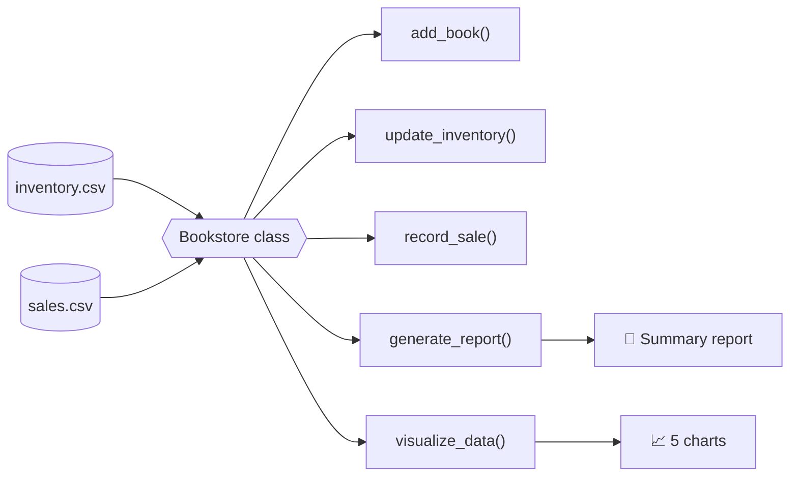
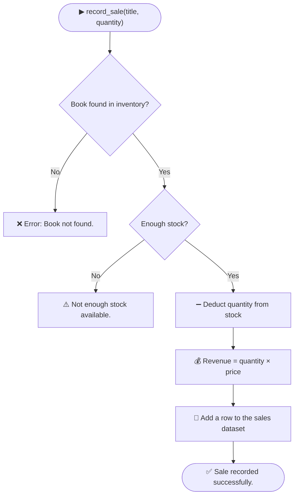

<div align="center">


<a href="https://git.io/typing-svg">
  
</a>

<br/>

<a href="https://git.io/typing-svg">
  
</a>

<br/>


<br/>


<br/><br/>

<table align="center">
  <tr>
    <td align="center" width="170"><h2>📊 5</h2><sub><b>Analytical charts</b></sub></td>
    <td align="center" width="170"><h2>🗄️ 2</h2><sub><b>CSV datasets</b></sub></td>
    <td align="center" width="170"><h2>🧱 1</h2><sub><b>Bookstore class</b></sub></td>
    <td align="center" width="170"><h2>🐍 4</h2><sub><b>Python libraries</b></sub></td>
  </tr>
</table>

</div>


## 📑 Table of Contents

1. [Project Overview](#-project-overview)
2. [Problem Statement & Objectives](#-problem-statement--objectives)
3. [Core Features](#-core-features)
4. [System Architecture](#-system-architecture)
5. [Dataset Architecture](#-dataset-architecture)
6. [Class Design & Methods](#-class-design--methods)
7. [Python Concepts Explained](#-python-concepts-explained)
8. [Data Visualization Engine](#-data-visualization-engine)
9. [Usage & Demo Run](#-usage--demo-run)
10. [Tech Stack](#-tech-stack)
11. [Setup Guide](#-setup-guide)
12. [Project Structure](#-project-structure)
13. [Future Enhancements](#-future-enhancements)
14. [Learning Outcomes](#-learning-outcomes)
15. [Show Your Support](#-show-your-support)
16. [Author](#-author)


## 🚀 Project Overview

Welcome to the **BookStore Inventory and Analytics System** 📚

This is a Python application that helps a bookstore run its day-to-day work: it keeps track of stock, records sales, checks every input, and turns the raw numbers into clear **business reports and charts**. It was built as a B.Tech CSE project that connects two worlds, **software engineering** (Object-Oriented Programming) and **data analytics** (Pandas, NumPy, Matplotlib and Seaborn).

Instead of manual ledgers or scattered spreadsheets, everything runs through one clean `Bookstore` class:

| 📚 Manage | 💰 Sell | 📊 Analyze |
|:---|:---|:---|
| Add new books and restock existing ones | Check stock, deduct it and calculate revenue automatically | Get a summary report and five charts with one call each |


## 🎯 Problem Statement & Objectives

A bookstore handles many titles, many authors, different prices and a constant stream of sales. Without an automated system, owners struggle to answer questions like:

- 💡 *Which genres bring in the most revenue?*
- ✍️ *Is one author outperforming the others?*
- 📅 *How is the business growing month by month?*
- 💲 *Do cheaper books really sell more?*

### 🎯 Project Objectives

| # | Objective | How the project achieves it |
|:---:|---|---|
| 1 | 🗃️ **Automate inventory** | `add_book()` and `update_inventory()` with built-in validation |
| 2 | 💵 **Track finances** | `record_sale()` deducts stock and logs revenue for every sale |
| 3 | 🔢 **Extract insights** | `generate_report()` uses NumPy for total revenue and average price |
| 4 | 📈 **Visualize trends** | `visualize_data()` renders five charts with Matplotlib and Seaborn |


## ✨ Core Features

| | Feature | What it does |
|:---:|---|---|
| 🟢 | **Smart inventory management** | Add a book with its title, author, genre, price and quantity |
| 🔄 | **Dynamic stock updates** | Restock an existing title without creating duplicate rows |
| 🛡️ | **Strict data validation** | Rejects negative prices, zero quantities, unknown titles and oversized sales |
| 🛒 | **Automated point of sale** | Checks stock, deducts the sold copies, calculates revenue and logs the transaction |
| 📝 | **Instant financial report** | Prints total revenue, average book price and the current stock list |
| 📊 | **One-click visual analytics** | Merges both datasets and renders five professional charts |
| 🔗 | **Dataset merging** | Joins sales with inventory to discover the genre and author of every sale |


## 🧭 System Architecture

The two CSV files act as the database. The `Bookstore` class loads them once and exposes every operation as a method.



### 🛒 How a sale is processed




## 📦 Dataset Architecture

The project uses two `.csv` (Comma Separated Values) files that act as its database.

### 1️⃣ `inventory.csv` — current stock

```csv
Title,Author,Genre,Price,Quantity
```

| Column | Type | Description |
|:---|:---:|:---|
| **Title** | String | Name of the book |
| **Author** | String | Writer of the book |
| **Genre** | String | Category, for example Technology or Education |
| **Price** | Float | Cost of a single copy |
| **Quantity** | Integer | Number of copies currently in stock |

### 2️⃣ `sales.csv` — every transaction

```csv
Date,Title,Quantity Sold,Total Revenue
```

| Column | Type | Description |
|:---|:---:|:---|
| **Date** | String | Format `YYYY-MM-DD` |
| **Title** | String | Name of the book sold |
| **Quantity Sold** | Integer | Copies purchased in the transaction |
| **Total Revenue** | Float | Calculated as `Quantity Sold × Price` |

> 🔗 Both files are connected through the **`Title`** column, which is what makes the genre and author analysis possible.


## 🧱 Class Design & Methods

Everything lives inside one class: **`Bookstore`**.

| Method | Parameters | What it does | Messages it prints |
|:---|:---|:---|:---|
| `__init__()` | none | Loads `inventory.csv` and `sales.csv` into Pandas DataFrames | none |
| `add_book()` | `title, author, genre, price, quantity` | Appends a new row to the inventory if price and quantity are positive | `Book added to inventory.` / `Error: Price and quantity must be positive.` |
| `update_inventory()` | `title, quantity` | Adds copies to an existing book's stock | `Inventory updated.` / `Error: Book not found.` / `Error: Quantity must be positive.` |
| `record_sale()` | `title, quantity` | Verifies stock, deducts it, calculates revenue and logs the sale | `Sale recorded successfully.` / `Not enough stock available.` / `Error: Book not found.` |
| `generate_report()` | none | Prints total revenue, average price and the stock list using NumPy | Summary report |
| `visualize_data()` | none | Merges the datasets and draws five charts | Five chart windows |

### 🛡️ Validation rules at a glance

| Situation | Result |
|---|---|
| Price or quantity is zero or negative when adding a book | ❌ Rejected |
| Restock quantity is zero or negative | ❌ Rejected |
| Restocking or selling a title that does not exist | ❌ Rejected |
| Selling more copies than are in stock | ⚠️ Rejected, stock stays unchanged |
| Valid sale | ✅ Stock reduced, revenue logged |


## 🧠 Python Concepts Explained

This project puts the core of Python and the data science stack into practice.

### 🏗️ 1. Object-Oriented Programming (OOP)

- **Encapsulation:** the data (`self.inventory`, `self.sales`) and the methods that change it (`add_book`, `record_sale` and others) are bundled inside one class.
- **Constructor (`__init__`):** the moment a `Bookstore` object is created, the two datasets are loaded automatically.

```python
class Bookstore:
    def __init__(self):
        self.inventory = pd.read_csv("inventory.csv")
        self.sales = pd.read_csv("sales.csv")
```

### 🚦 2. Control Structures & Defensive Programming

- **Conditionals (`if / else`)** protect the data, for example `if price > 0 and quantity > 0:` stops impossible values like a book costing a negative amount.
- **Loops (`for`)** scan the DataFrame row by row to find a title:

```python
for index, row in self.inventory.iterrows():
    if row['Title'] == title:
        ...
```

### 🐼 3. Data Manipulation with Pandas

| Concept | Where it is used |
|---|---|
| **DataFrames** | CSV files are loaded into fast in-memory tables |
| **`pd.merge`** | `pd.merge(self.sales, self.inventory, on='Title')` joins sales with inventory, like an SQL join |
| **`groupby`** | Groups data by genre, author, title or month before summing |
| **`.loc` / `.at`** | Adds new rows and updates single cells |

### ✂️ 4. String Slicing

Daily dates like `"2026-10-10"` are cut down to `"2026-10"` with `date[0:7]`, which gives a clean **YYYY-MM** key for the monthly trend chart.

### 🔢 5. High-Performance Math with NumPy

Pandas columns are converted to NumPy arrays with `.values`, then `np.sum()` gives total revenue and `np.mean()` gives the average book price.

### 🎨 6. Visualization with Matplotlib & Seaborn

Matplotlib draws the bar, line and pie charts, and Seaborn draws the correlation heatmap.


## 📈 Data Visualization Engine

Data is only useful when you can understand it. `visualize_data()` turns the project into a small **Business Intelligence dashboard** with five charts.

| # | Chart | Type | Question it answers |
|:---:|---|:---:|---|
| 1 | Total Sales by Genre | 📊 Bar | Which categories sell the most copies? |
| 2 | Total Sales by Author | 🟢 Bar | Who are the best-selling writers? |
| 3 | Monthly Sales Trends | 📈 Line | Is revenue growing or falling over time? |
| 4 | Revenue Share by Genre | 🍕 Pie | Which genres earn the most money? |
| 5 | Price vs. Sales Volume | 🌡️ Heatmap | Do higher prices hurt sales? |

### 📊 1. Total Sales by Genre (Bar Chart)

- **Visual:** blue vertical bars.
- **Code logic:** groups the merged data by `Genre` and sums `Quantity Sold`.
- **Business insight:** shows exactly which book categories are flying off the shelves, so the owner knows what to reorder.

### 🟢 2. Total Sales by Author (Bar Chart)

- **Visual:** green vertical bars.
- **Code logic:** groups the merged data by `Author` and adds up the copies sold per writer.
- **Business insight:** reveals the store's star authors, which helps with book signings and special displays.

### 📈 3. Monthly Sales Trends (Line Graph)

- **Visual:** green line with circle markers (`marker='o'`) plotting month against revenue.
- **Code logic:** slices each date into `YYYY-MM`, groups by month and sums `Total Revenue`.
- **Business insight:** the key health check of the business, showing seasonal peaks and worrying drops.

### 🍕 4. Revenue Share by Book Genre (Pie Chart)

- **Visual:** multi-colored pie with percentage labels (`autopct='%1.1f%%'`).
- **Code logic:** groups by `Genre` and sums `Total Revenue` instead of quantity.
- **Business insight:** separates **volume** from **money**. A genre may sell fewer copies but still earn a large share because of higher prices.

### 🌡️ 5. Price vs. Sales Volume (Seaborn Heatmap)

- **Visual:** blue-toned heatmap (`cmap='Blues'`) with the correlation values written on it.
- **Code logic:** calculates the correlation between `Price` and `Quantity Sold` across book titles.
- **Business insight:** a strong negative value suggests higher prices are reducing sales, which hints that the store should stock more affordable titles.


## 🎮 Usage & Demo Run

### ▶️ Quick start in code

```python
# 1. Create the store (loads both CSV files)
store = Bookstore()

# 2. Add a brand-new book
store.add_book("HTML Basics", "John Smith", "Technology", 20.0, 30)

# 3. Restock an existing book
store.update_inventory("Python Basics", 10)

# 4. Sell some copies
store.record_sale("Data Science 101", 5)

# 5. Print the summary report
store.generate_report()

# 6. Show all five charts
store.visualize_data()
```

### 🖥️ Expected console flow

```text
Testing Add Book:
Book added to inventory.

Testing Update Inventory:
Inventory updated.

Testing Record Sale:
Sale recorded successfully.

Testing Reports:

--- Summary Report ---
Total Revenue:  <total from sales.csv>
Average Book Price:  <mean of all prices>

Inventory:
<Title and Quantity of every book>

Generating Visualizations...
```

### 🧪 Try the safeguards

```python
store.add_book("Bad Book", "Nobody", "Test", -5, 10)   # Error: Price and quantity must be positive.
store.update_inventory("Unknown Title", 5)             # Error: Book not found.
store.record_sale("Python Basics", 100000)             # Not enough stock available.
```

> 💡 **Good to know:** the changes made while the program runs (new books, restocks, sales) live in memory during that run. Saving them back to the CSV files is listed under [Future Enhancements](#-future-enhancements).


## 🧰 Tech Stack

| Tool | Purpose |
|---|---|
| 🐍 **Python 3.8+** | Core language and OOP |
| 🐼 **Pandas** | Loading CSVs, merging, grouping and updating data |
| 🔢 **NumPy** | Fast numerical calculations (sum and mean) |
| 📊 **Matplotlib** | Bar, line and pie charts |
| 🎨 **Seaborn** | Correlation heatmap |
| 📄 **CSV files** | Lightweight database for inventory and sales |


## 💻 Setup Guide

### ✅ Prerequisites

- 🐍 Python **3.8 or higher**
- 📝 A code editor (VS Code, PyCharm and so on) or a plain terminal

### 🪜 Step-by-step installation

**1️⃣ Clone or download the project**

```bash
git clone https://github.com/<your-username>/bookstore-inventory-analytics.git
cd bookstore-inventory-analytics
```

Make sure `BookStore.py`, `inventory.csv` and `sales.csv` are in the **same folder**.

**2️⃣ Install the required libraries**

```bash
pip install pandas numpy matplotlib seaborn
```

**3️⃣ Run the project**

```bash
python BookStore.py
```

> 🖼️ Each chart opens in its own window. **Close one window to see the next chart.**

<details>
<summary><b>🛠️ Troubleshooting (click to expand)</b></summary>

<br/>

| Problem | Fix |
|---|---|
| `FileNotFoundError: inventory.csv` | Run the script from the folder that contains the CSV files |
| `ModuleNotFoundError` | Run `pip install pandas numpy matplotlib seaborn` again |
| `KeyError` on a column name | Check the CSV headers match exactly: `Title, Author, Genre, Price, Quantity` and `Date, Title, Quantity Sold, Total Revenue` |
| Charts do not appear | Make sure you run it on a computer with a display, or inside Jupyter or VS Code |

</details>


## 📂 Project Structure

```text
bookstore-inventory-analytics/
│
├── 🐍 BookStore.py        # Main program with the Bookstore class
├── 📄 inventory.csv       # Current stock database
├── 📄 sales.csv           # Sales transaction log
├── 📖 README.md           # You are here
│
└── 🖼️ assets/
    ├── bookstore-pulse.svg   # Animated sales chart banner
    └── divider.svg           # Animated section divider
```


## 🔮 Future Enhancements

- [ ] 🖥️ **Graphical User Interface:** build a desktop app with **Tkinter** or **PyQt**
- [ ] 🗄️ **Database integration:** move from CSV files to **SQLite** or **MySQL** for better data security
- [ ] 🤖 **Machine learning predictions:** forecast next month's sales with **scikit-learn**
- [ ] 💾 **Save changes:** write the updated inventory and sales back to the CSV files with `to_csv()`
- [ ] 📅 **Automatic dates:** use today's date for new sales instead of a fixed value
- [ ] 🔁 **Duplicate protection:** stop the same title from being added twice
- [ ] 📤 **Export reports:** save the summary report and charts as PDF or image files
- [ ] 🔍 **Search and filter:** look up books by author, genre or price range


## 🎓 Learning Outcomes

By building this project I practiced:

- 🏗️ Designing a real-world system with **Object-Oriented Programming**
- 🛡️ Writing **defensive code** with input validation
- 🐼 Cleaning, merging and grouping data with **Pandas**
- 🔢 Doing fast numerical analysis with **NumPy**
- 📊 Turning raw data into business stories with **Matplotlib** and **Seaborn**
- 🧩 Structuring a project so that it is easy to read, run and extend


## ⭐ Show Your Support

If you found this project helpful or interesting, please give it a **star** ⭐ on GitHub. It means a lot!


## 🙋 Author

<div align="center">

### Made with ❤️ and Python by

<a href="https://git.io/typing-svg">
  
</a>


</div>
